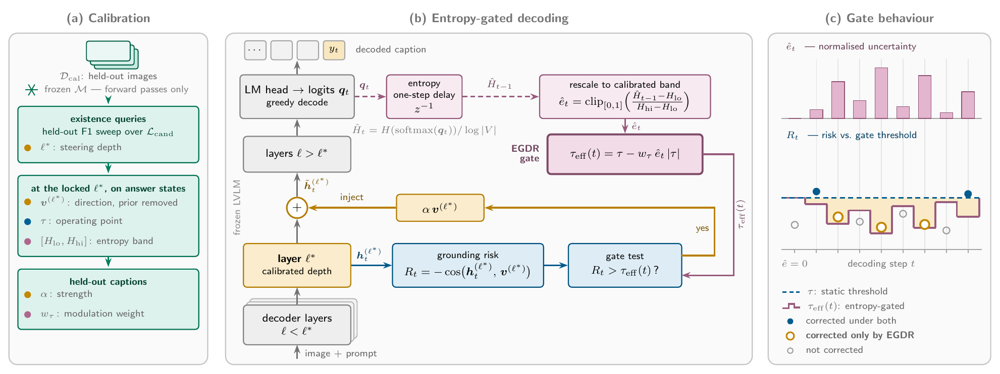

# Entropy-Gated Dynamic Rectification for Object Hallucination in Large Vision-Language Models

Riasad Alvi<sup>1</sup>, Md. Asaduzzaman Shuvo<sup>1</sup>, Md. Ahashan Habib<sup>1</sup>, Md. Faiyaz Abdullah Sayeedi<sup>1,2</sup><br>
<sup>1</sup>United International University, Bangladesh &nbsp; <sup>2</sup>BRAC University, Bangladesh

WACV 2027 · [Project page](https://alvi-uiu.github.io/EGDR/)

EGDR replaces the constant threshold of risk-gated latent steering with one that
is lowered when the preceding decoding step is uncertain. The steering
direction, depth and strength are unchanged; no parameter is trained and no
model forward pass is added.



## Method

| | Equation | Paper |
|---|---|---|
| Risk | `R_t = -cos(h_t, v)` | Eq. 2 |
| Normalized entropy | `H_t = H(p(. \| x_<t)) / log\|V\|` | Eq. 4 |
| Threshold | `tau = Percentile(S_fact, k)` | Eq. 5 |
| Rescaled entropy | `e_t = clip((H_{t-1} - H_lo) / (H_hi - H_lo), 0, 1)` | Eq. 6 |
| Effective threshold | `tau_eff(t) = tau - w_tau * e_t * \|tau\|` | Eq. 7 |
| Update | `h_t <- h_t + alpha * 1(R_t > tau_eff(t)) * v` | Eq. 8 |

The static gate is the case `w_tau = 0`. At the first generated token
`e_t = 0`, so `tau_eff = tau`.

## Installation

```bash
git clone https://github.com/alvi-uiu/EGDR.git && cd EGDR
conda create -n egdr python=3.10 -y && conda activate egdr
pip install torch --index-url https://download.pytorch.org/whl/cu121
pip install -e .
```

## Calibration

```bash
CFG=configs/llava15_7b.yaml
python scripts/compute_direction.py --config $CFG   # steering direction (Eq. 1)
python scripts/select_layer.py      --config $CFG   # depth on the development panels (Eq. 9)
python scripts/calibrate.py         --config $CFG   # tau (Eq. 5) and entropy band (Eq. 6)
python scripts/select_strength.py   --config $CFG   # alpha and w_tau on calibration captions
```

The calibration pool (`data/calibration/pool.json`) holds 100 COCO train2014
images with 500 balanced existence queries; the nine further development
panels are built on first use. COCO images are downloaded to `data/coco/`. For
LLaVA-1.5-7B the configuration already holds the locked operating point
(`layer 30`, `alpha 1.1`, `k 0.8`, `w_tau 0.5`); for LLaVA-NeXT-7B
(`configs/llava_next_7b.yaml`) all four scripts are run.

## Usage

```bash
python scripts/caption.py --config $CFG --image path/to/image.jpg
```

describes an image with unsteered decoding (`regular`), the static gate
(`static`) and EGDR (`egdr`). The hooks can also be used directly:

```python
from egdr import GateSpec, Steering, load_direction

direction = load_direction("outputs/llava15_7b/direction.pt", layer=30)
spec = GateSpec(alpha=1.1, tau=tau, w_tau=0.5, h_lo=h_lo, h_hi=h_hi)  # from calibration.json
with Steering(model, direction, spec) as st:
    st.reset()                      # before every generate call
    out = model.generate(**inputs, do_sample=False, max_new_tokens=512)
```

Existence answers are labeled from their first sentence: `no` if it contains a
standalone "no" or "not", `yes` otherwise, and an empty answer counts as `no`.
Depth is selected by the mean first-token F1 of the static gate over the
development panels.

## Repository structure

```
egdr/       gate (Eq. 2, 4-8), hooks, direction (Eq. 1), calibration (Eq. 5, 6), generation
scripts/    calibration and inference
configs/    LLaVA-1.5-7B and LLaVA-NeXT-7B
data/       calibration pool
docs/       project page (GitHub Pages)
```

## Citation

```bibtex
@inproceedings{alvi2027egdr,
  title     = {Entropy-Gated Dynamic Rectification for Object Hallucination in Large Vision-Language Models},
  author    = {Alvi, Riasad and Shuvo, Md. Asaduzzaman and Habib, Md. Ahashan and Sayeedi, Md. Faiyaz Abdullah},
  booktitle = {Proceedings of the IEEE/CVF Winter Conference on Applications of Computer Vision (WACV)},
  year      = {2027}
}
```

## License

Apache License 2.0.
